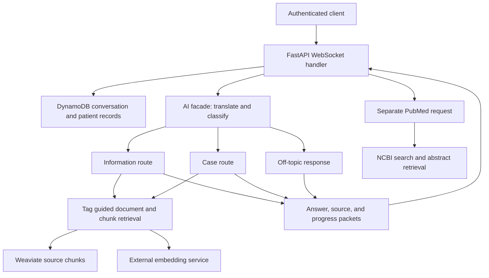

# HEKADES Backend

**Archived backend source from HEKADES, a startup I founded in 2024 at KWORKS, Koç University's entrepreneurship center.**

HEKADES stands for *Hekim Karar Destek*, or physician decision support. The project explored how large language models could help clinicians research medical questions using source material, rather than relying entirely on a model's internal knowledge.

This repository preserves the backend as a technical portfolio and a record of the algorithms, architecture, and experiments we developed. **The backend is not in a runnable state.** It is published for reading and studying the implementation. Dependencies, external services, credentials, datasets, and historical infrastructure are not supplied as a working system.

## Why we built it

In 2024, general-purpose language models could produce convincing medical answers whose sources were difficult to verify. HEKADES explored a more structured workflow: retrieve relevant literature, assemble source context, generate a response, and provide references that a clinician could inspect.

The backend investigated two related tasks:

- Answering general medical information questions using an indexed collection of source documents.
- Researching questions about a specific patient case, with a separate path for discovering relevant PubMed literature.

The project developed in the KWORKS / Koç University entrepreneurship environment, following discussions with professors from the University of Health Sciences. It did not reach a commercial launch. Access to and licensing of medical guideline content were among the obstacles to taking the product further.

The implementation reflects our work during that period. It does not establish clinical validation, medical accuracy, or suitability for patient care.

## My contribution and the development context

I founded HEKADES and worked on its backend engineering. I am publishing this source to make my technical work inspectable: the retrieval logic, model orchestration, asynchronous request handling, data boundaries, and infrastructure integration can be explored directly in code.

This work dates to 2024, when AI coding agents were still early and limited. By my own retrospective estimate, approximately **80% of the code was written manually**. That figure is a personal estimate, not a measurement from tooling or a code-provenance study. AI assistance was part of the development context, while most implementation work was hands-on.

HEKADES was a collaborative project. This repository includes work by other contributors, and its publication should not be read as a claim that I personally authored every component or prompt.

## Architecture at a glance

The code separates HTTP and WebSocket interfaces, business entities and use cases, AI pipelines, and storage adapters. A dependency container connects those layers to the historical model and infrastructure providers.

This diagram describes the responsibilities and calls visible in the archived source. It does not represent a currently operating deployment.

## How a question moved through the backend

The main question interface is a WebSocket under `/conversation/`. Its request schema distinguishes a new conversation from a separate PubMed search request.

1. **Authenticate and establish state.** The handler checks the user's token, validates the incoming packet, optionally checks access to a selected patient, and creates the conversation and user message.
2. **Translate and classify.** The AI facade translates the question and uses model calls to choose an information, case, or off-topic route.
3. **Retrieve context.** The substantive routes select topic tags, identify matching documents, and search their source chunks.
4. **Generate the response.** The selected route supplies context to model prompts and produces typed answer, source, and progress packets.
5. **Stream and save.** The WebSocket handler forwards packets and accumulates answer phases and source mappings for persistence.

Useful entry points are [`conversation_router.py`](interface/routers/conversation/conversation_router.py), [`HekadesAIFacade`](ai/hekades_ai_facade.py), and the [`ResponsePacket` types](business/ai/ai_facade.py).

## Document ingestion and retrieval

### Annotated documents and page references

The annotated-text ingestion path uses a manually prepared document format with chunk boundaries, page annotations, a table of contents, and topic tags. It applies a sequence of transformations:

1. Split annotated excerpts into page-aware nodes.
2. Translate non-English chunk text into English.
3. Generate summaries intended to help match medical questions to the material.
4. Convert nodes into source chunks with source IDs and page metadata.
5. Embed and store the content and summaries in Weaviate.

See the [`annotated text pipeline`](ai/indexing/indexing_pipeline/annotated_text_file_indexing_pipeline.py), [`manual splitter`](ai/indexing/doc_parser/page_aware_manual_splitter.py), [`translator`](ai/indexing/doc_parser/chunk_translator.py), and [`summarizer`](ai/indexing/doc_parser/chunk_summarizer.py).

The repository also contains a PDF parsing path using Unstructured and image/table summarization. That older path is inconsistent with the current chunk schema and should be treated as incomplete archival code.

### Selecting documents before searching passages

Retrieval starts with model-selected tags. Matching table-of-contents chunks identify a set of source documents, and subsequent chunk searches are restricted to those source IDs. This makes document selection an explicit stage before passage retrieval.

The Weaviate adapter performs hybrid searches that combine a text query with an embedding vector. Its collection defines separate named vectors for content and summaries; the hybrid query targets the summary vector while the answer prompts receive the chunk content.

The retrieval code also contains query expansion, query scoring, custom score fusion, and chunk deduplication. Their use varies by route and configuration. A method named reciprocal rank fusion uses a custom score-based calculation, so it should not be assumed to be a conventional implementation of rank-position-based RRF.

See [`DocAwareMultilangFusionRetriever`](ai/retrieval/fusion/doc_aware_multilang_fusion_retriever.py), [`FusionRetriever`](ai/retrieval/fusion/fusion_retriever.py), and [`WeaviateVectorIndex`](data/indexing/vector_index/weaviate_vector_index.py).

### Sources and citations

Prompts number the retrieved passages and ask models to cite them. Source packets map those numbers to source IDs and page metadata. The case route also consolidates citation numbering across its tag-specific answers.

This is a source-navigation mechanism. The code does not independently verify that every generated statement is supported by the passage it cites.

## Information, case, and literature workflows

### Information questions

The [`information route`](ai/query_routes/information/information_query_route.py) reformulates a question, selects tags, retrieves source chunks, assembles a source-filled prompt, and streams the response. When retrieval returns no chunks, it takes a no-information branch.

### Patient-case questions

The [`case route`](ai/query_routes/case/case_query_route.py) uses a different orchestration. It prepares case context, performs parallel tag selection, runs a retrieval and analysis pipeline for each selected tag, consolidates sources, and generates an integrated answer and takeaway.

These tag agents are application-level model pipelines. They are distinct from the coding agents mentioned in the development-history section above.

### PubMed literature research

The [`PubMed retriever`](ai/retrieval/pubmed/pubmed_retriever.py) is a separate path. It generates Boolean search terms, combines them with a journal ISSN filter, retrieves article metadata and abstracts through NCBI Entrez, reranks articles using embedding cosine similarity, and passes selected abstracts to a summarization prompt.

This is an abstract-based discovery and summarization workflow, not evidence of a comprehensive or clinically validated literature review.

## Models, storage, and infrastructure

The historical dependency wiring includes GPT-4o and GPT-4o-mini through OpenAI, Llama 3.1 through AWS Bedrock, an external embedding service configured with `dunzhang/stella_en_1.5B_v5`, and a Command R+ adapter. Configured adapters are not necessarily invoked by every active route. The Llama adapter includes fallback calls to an OpenAI model when an error occurs.

Storage responsibilities are split across DynamoDB for application records, Weaviate for searchable source chunks, and S3 for source files and extracted resources. The repository also includes Docker, an AWS buildspec, and development Weaviate configuration. Those files record the integration work; they do not provide a reproducible deployment today.

The main wiring is in [`main/dependency_container.py`](main/dependency_container.py).

## Repository map

| Directory | What to look for |
|---|---|
| `main/` | Application entry point, dependency container, configuration and logging |
| `interface/` | FastAPI routers, authentication, WebSocket schemas and serialization |
| `business/` | Domain entities, repository interfaces and use cases |
| `ai/indexing/` | Document parsing, translation, summarization and embedding |
| `ai/retrieval/` | Tag selection, hybrid search, fusion and PubMed discovery |
| `ai/query_routes/` | Information, case, off-topic and tag-agent orchestration |
| `ai/models/` | Model adapters and function-call tools |
| `data/` | DynamoDB, S3 and Weaviate implementations |
| `infrastructure/` | Historical dependency, container and build configuration |
| `__unittests__/` | Unit tests, mocks and library experiments |
| `__integration_tests__/` | Integration tests and source fixtures |

## Archive status and known limitations

This is a source archive, not a maintained application or an installation guide. The historical requirements and infrastructure files do not make it runnable as published. Tests are retained as implementation context and are not a claim that the current snapshot passes them.

Known limitations include:

- Inconsistencies between older ingestion paths and the current chunk model.
- A positional argument mismatch that affects how generated case-search queries reach the retriever.
- Incomplete ownership enforcement in the PubMed conversation request path.
- Logging patterns that would require review before handling sensitive data.
- External-service assumptions, incomplete dependency pinning, and no supplied operational environment.
- No published clinical validation, reproducible retrieval benchmark, or calibrated confidence measure.

The repository should not be deployed with patient data or used to make clinical decisions. Its value is in the engineering ideas and their implementation, including the places where the design remained unfinished.

## License

Original project code is released under the [MIT License](LICENSE), with attribution to the HEKADES contributors. Third-party materials, including document fixtures and external dependencies, retain their respective copyrights and license terms; the project license does not relicense those materials.
